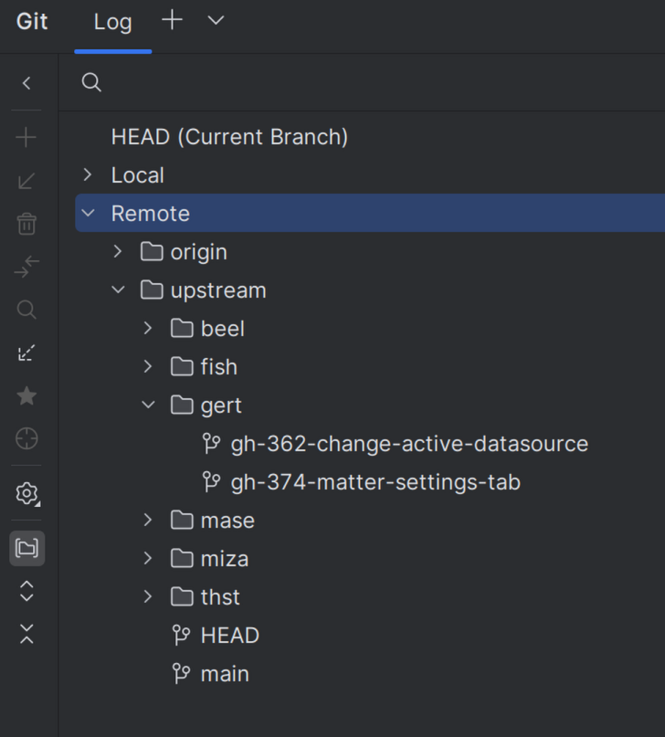

# Contributing

Various contributing guidelines we as the Eclipse Team want to hold ourselves to.
These apply to all repositories inside the eclipse-energy organization.

## IDE

Our IDE of choice is IntelliJ idea (and VS Code for frontend). Repositories and style guides are setup with these 2 IDEs in mind.

## Branches

Branch names should always follow this convention:

"USER_SHORTNAME/GH_ISSUE my awesome branch"

e.g. `gert/gh-01 create contributing guidelines`

This allows us to quickly identify whose responsible for the branch and for what reason the branch exists.
In the rare case that there is no ascociated issue for the branch please use `noissue`:

e.g. `gert/noissue testing some stuff locally`

Following these conventions will cause branches to look like this in IntelliJ Idea:

## Commits

- Commits should start with the issue number: e.g. `GH-01:`
- Commit messages should be short and descriptive.
- Try to keep commits short and commit often.

## Pull requests

see also: [Code Review Guidelines]().

- Keep PRs small and focused on one change / issue.
- Make sure CI passes before requesting review.
- Review your own PR yourselve before requesting review (Draft PR).
- Respond to review comments and keep the discussion on the PR.
